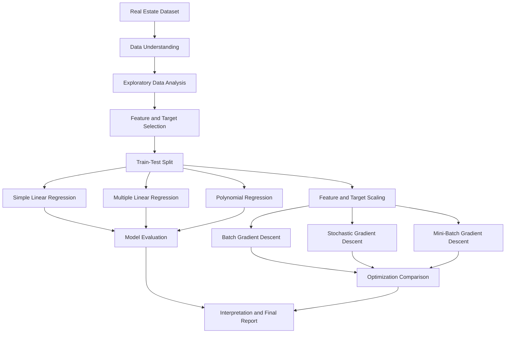

# 🏡 House Price Prediction — Advanced Regression & Optimization

<div align="center">

### Turning Real Estate Data into Data-Driven Price Predictions

A Machine Learning project exploring regression algorithms, model evaluation, feature relationships, and Gradient Descent optimization to predict house prices using property characteristics.

<br>


**Project Type:** Supervised Machine Learning · Regression · Optimization

**Target Variable:** `house_price_inr`

</div>

---

# 🎥 Project Video

<p align="center">
  <a href="https://drive.google.com/drive/folders/1e46UB6OhIEoYKcM0EHFV3xyLvHr5pV3b?usp=sharing" target="_blank">
    
  </a>
</p>

<p align="center">
Click the button above to watch the complete project demonstration.
</p>

---

## 📌 Table of Contents

- [Project Overview](#-project-overview)
- [Business Problem](#-business-problem)
- [Project Objectives](#-project-objectives)
- [Dataset Description](#-dataset-description)
- [Technology Stack](#-technology-stack)
- [Project Workflow](#-project-workflow)
- [Exploratory Data Analysis](#-exploratory-data-analysis)
- [Regression Models](#-regression-models)
- [Gradient Descent Optimization](#-gradient-descent-optimization)
- [Model Evaluation](#-model-evaluation)
- [Results and Insights](#-results-and-insights)
- [Bias–Variance Analysis](#-biasvariance-analysis)
- [Business Applications](#-business-applications)
- [Project Structure](#-project-structure)
- [How to Run](#-how-to-run)
- [Limitations and Future Improvements](#-limitations-and-future-improvements)
- [Final Conclusion](#-final-conclusion)

---

## 🎯 Project Overview

House prices depend on several factors, including property size, location, number of rooms, distance from the city, and available facilities.

The goal of this project is to develop and evaluate Machine Learning regression models that estimate house prices from these property characteristics.

Rather than using only one algorithm, this project compares different regression approaches and investigates how optimization techniques can minimize prediction loss.

The project covers the end-to-end regression workflow, from understanding the dataset and exploring feature relationships to training models, evaluating predictions, implementing Gradient Descent from scratch, and interpreting results.

### What makes this project interesting?

- 📊 Explores relationships between property characteristics and house prices.
- 📈 Compares Simple Linear, Multiple Linear, and Polynomial Regression.
- 🧮 Implements Batch, Stochastic, and Mini-Batch Gradient Descent from scratch.
- 📉 Evaluates models using multiple regression metrics.
- ⚖️ Studies model complexity, bias, variance, and generalization.
- 💼 Translates statistical results into practical real-estate insights.

## 💼 Business Problem

Real-estate pricing can be challenging because similar properties may have different values depending on their size, location, facilities, and other characteristics.

A data-driven pricing model can help identify relationships between these characteristics and historical house prices.

**Problem statement:**

> Can we predict house prices in INR using property-related features, and which regression approach provides the best predictive performance on unseen data?

This project treats house-price prediction as a **supervised regression problem**, where historical examples contain input features and a known target price.

## 🎯 Project Objectives

1. Understand the dataset's structure and statistical properties.
2. Explore relationships between independent features and house prices.
3. Identify features with strong positive or negative correlations with the target.
4. Train Simple Linear Regression, Multiple Linear Regression, and Polynomial Regression models.
5. Evaluate models using MSE, MAE, RMSE, R², and Adjusted R².
6. Implement three Gradient Descent optimization methods from scratch.
7. Compare optimization loss curves and training time.
8. Analyze underfitting, overfitting, and the bias–variance trade-off.
9. Identify the strongest model based on the available test results.
10. Interpret the findings in a real-world business context.

## 📂 Dataset Description

The dataset used in this project is named `RealEstate_HousePrice_Dataset_4200.xlsx`.

The filename indicates a dataset of 4,200 records. The dataset contains 12 columns: one house identifier, ten potential predictor features, and one target variable.

| Column | Description |
|---|---|
| `house_id` | Unique house identifier |
| `area_sqft` | House area in square feet |
| `bedrooms` | Number of bedrooms |
| `bathrooms` | Number of bathrooms |
| `location_score` | Numerical score representing location quality |
| `age_years` | Age of the property |
| `distance_city_km` | Distance from the city in kilometres |
| `lot_size_sqft` | Total plot size in square feet |
| `has_garage` | Indicates whether a garage is available |
| `has_pool` | Indicates whether a pool is available |
| `renovation_years_ago` | Time since the last renovation |
| `house_price_inr` | Target variable: house price in INR |

### Feature and Target Selection

**Input features (X):** The ten property-related columns, excluding `house_id` and `house_price_inr`.

**Target variable (y):** `house_price_inr`.

The house identifier is excluded because it identifies a record rather than representing a meaningful property characteristic for prediction.

## 🛠️ Technology Stack

| Technology | Purpose |
|---|---|
| Python | Core programming language |
| Pandas | Dataset loading, manipulation, and analysis |
| NumPy | Numerical calculations and Gradient Descent implementation |
| Matplotlib | Data visualization, regression plots, and loss curves |
| Scikit-learn | Data splitting, scaling, and regression model implementation |
| Jupyter Notebook | Interactive development, experimentation, and documentation |

## 🔄 Project Workflow

The project follows a structured Machine Learning pipeline.



### Step 1 — Data Understanding

The dataset's columns and their roles were identified before modelling.

The main tasks included:

- Understanding numerical and categorical/binary features.
- Identifying the target variable.
- Separating predictive features from the house identifier.
- Reviewing feature relationships and statistical summaries.

### Step 2 — Exploratory Data Analysis (EDA)

EDA was used to understand how house prices vary with property characteristics.

Correlation analysis helped identify features with strong linear relationships with the target. Scatter plots were used to visualize relationships between area and price, while regression plots helped compare fitted models.

### Step 3 — Train-Test Split

The data was divided into training and testing subsets using an 80/20 split and `random_state=42`.

- **Training set:** Used to fit the models.
- **Testing set:** Used to evaluate performance on held-out observations.

This separation helps assess whether a model generalizes beyond the examples used during training.

### Step 4 — Model Training

Three regression approaches were trained and compared:

1. Simple Linear Regression
2. Multiple Linear Regression
3. Degree-2 Polynomial Regression

### Step 5 — Gradient Descent

The training features and target were standardized. Batch, Stochastic, and Mini-Batch Gradient Descent were then implemented from scratch to study parameter updates and convergence.

### Step 6 — Evaluation and Reporting

The models were evaluated using regression metrics, and the results were interpreted in terms of prediction error, model complexity, and potential business value.

---

## 📊 Exploratory Data Analysis

Correlation analysis was used to examine the linear relationship between each numerical feature and `house_price_inr`.

### Feature Correlation with House Price

| Feature | Correlation | Interpretation |
|---|---:|---|
| `area_sqft` | +0.7554 | Strong positive relationship |
| `bedrooms` | +0.6448 | Positive relationship |
| `location_score` | +0.5885 | Positive relationship |
| `lot_size_sqft` | +0.5678 | Positive relationship |
| `bathrooms` | +0.5270 | Positive relationship |
| `renovation_years_ago` | -0.0374 | Very weak negative linear relationship |
| `age_years` | -0.0895 | Weak negative linear relationship |
| `distance_city_km` | -0.4694 | Moderate negative relationship |

*These are the previously observed correlation values from the project analysis.*

### Key EDA Findings

- `area_sqft` has the strongest positive correlation with house price among the listed features.
- Larger properties generally tend to have higher prices in this dataset.
- `distance_city_km` has a negative correlation, suggesting that properties farther from the city tend to have lower prices.
- Several other features have positive relationships with price.
- Weak correlation does not necessarily mean a feature has no predictive value. A feature may contribute through nonlinear relationships or interactions with other variables.

**Important:** Correlation describes association, not causation. These values alone do not establish that a feature causes a price change.

### Recommended EDA Visualizations

Save the actual plots generated in your notebook and reference them here.

| Visualization | Purpose |
|---|---|
| Correlation Heatmap | Displays relationships among numerical features |
| Area vs. House Price Scatter Plot | Shows how price varies with area |
| Linear vs. Polynomial Regression | Compares fitted relationships |
| Residual Plot | Helps inspect prediction errors and model assumptions |


## 🤖 Regression Models

### 1. Simple Linear Regression

**Definition:** Simple Linear Regression predicts a continuous target using one independent variable.

In this project, `area_sqft` was used as the single input feature to predict house price.

Mathematical representation:

\[
\hat{y} = b_0 + b_1x
\]

Where:

- \(\hat{y}\) = Predicted house price
- \(b_0\) = Intercept
- \(b_1\) = Slope
- \(x\) = House area

**Why this model was used:** It provides a simple baseline and helps evaluate how much predictive information can be captured by area alone.

**Limitation:** House prices depend on multiple characteristics, so area alone may not explain all the variation in prices.

### 2. Multiple Linear Regression

**Definition:** Multiple Linear Regression predicts a continuous target using two or more independent variables.

Mathematical representation:

\[
\hat{y}=b_0+b_1x_1+b_2x_2+\cdots+b_px_p
\]

The model uses multiple property characteristics, including area, bedrooms, bathrooms, location score, distance from the city, and other available features.

**Why this model was used:** It captures the combined linear contributions of several property characteristics.

**Observed result:** It achieved substantially better test performance than the Simple Linear Regression model in this experiment.

### 3. Polynomial Regression

**Definition:** Polynomial Regression extends regression by introducing powers of one or more input features to represent curved relationships.

For a degree-2 model using area:

\[
\hat{y}=b_0+b_1x+b_2x^2
\]

The model was trained using `area_sqft` and its quadratic transformation.

**Why this model was used:** It tests whether a nonlinear relationship between house area and price provides better predictions than a straight line.

**Observed result:** The degree-2 model performed almost identically to Simple Linear Regression, suggesting that adding the quadratic term provided little improvement on the test set.

### Regression Plot

The Linear vs. Polynomial Regression graph compares the observed house-price data with the fitted regression curves.

The close overlap between the two curves indicates that the quadratic term did not substantially change the fitted relationship over the plotted range.

This visualization supports the numerical comparison, although test metrics are required to judge predictive performance.

---

## ⚙️ Gradient Descent Optimization

Gradient Descent is an optimization algorithm that updates model parameters iteratively to minimize a loss function.

For this project, Mean Squared Error (MSE) was used as the optimization objective.

The parameter update rule is:

\[
\theta_{\text{new}}=\theta_{\text{old}}-\alpha\nabla J(\theta)
\]

Where:

- \(\theta\) = Model parameters
- \(\alpha\) = Learning rate
- \(J(\theta)\) = Loss function
- \(\nabla J(\theta)\) = Gradient of the loss

The features and target were standardized before optimization to improve numerical stability. An intercept column was added to the feature matrix.

### 1. Batch Gradient Descent

Batch Gradient Descent calculates the gradient using the entire training dataset before each parameter update.

**Characteristics:**

- Uses all training samples for each update.
- Often produces a relatively smooth loss trajectory.
- Each update can be computationally expensive on larger datasets.

### 2. Stochastic Gradient Descent (SGD)

SGD updates model parameters using one training sample at a time.

**Characteristics:**

- Makes frequent parameter updates.
- Can make rapid progress through the dataset.
- The loss curve can fluctuate because each update is based on one sample.

### 3. Mini-Batch Gradient Descent

Mini-Batch Gradient Descent updates parameters using a small subset of the training data.

**Characteristics:**

- Uses more samples per update than SGD.
- Usually requires less computation per update than full-batch training.
- Balances update frequency and gradient stability.

The project used a mini-batch size of 32.

### How the Methods Were Compared

The implementations were evaluated through:

- Training time
- Loss reduction across epochs
- Convergence behavior
- Test-set prediction metrics

The comparison must use the actual recorded results rather than assuming that one optimizer is always fastest or most accurate.

### Gradient Descent Visualization

The `gradient_descent_comparison.png` graph compares the recorded loss histories of Batch GD, SGD, and Mini-Batch GD.

Interpretation:

- A decreasing loss indicates progress in minimizing the objective.
- A fluctuating curve can be expected with stochastic updates.
- A curve that stops improving may indicate convergence or a need to tune the learning rate.
- Training time depends on dataset size, number of epochs, implementation, and hardware.

Because the methods may perform different numbers of parameter updates per epoch, equal epoch counts do not represent equal computational work.

---

## 📈 Model Evaluation

Model performance was evaluated using multiple metrics to capture different aspects of prediction error.

| Metric | Definition | Preferred Result |
|---|---|---|
| MSE | Average squared prediction error | Lower |
| MAE | Average absolute prediction error | Lower |
| RMSE | Square root of MSE, expressed in the target's units | Lower |
| R² | Measures explained variation relative to a mean-based baseline | Generally higher |
| Adjusted R² | Adjusts R² for the number of predictors and sample size | Useful for model comparison |

### Why Multiple Metrics?

A single metric may not provide a complete picture of model performance.

- **MAE** is easy to interpret as an average absolute prediction error.
- **RMSE** penalizes large prediction errors more heavily than MAE.
- **R²** summarizes how much target variation the model explains on the evaluated dataset.
- **Adjusted R²** accounts for the number of predictors, making it useful when comparing models with different feature counts.

For a house-price model, error metrics should be interpreted in INR and in the context of the prices being predicted.

## 🏆 Results and Insights

The following table summarizes the previously observed test results for the three regression models.

| Model | Test R² | Test RMSE | Test MAE |
|---|---:|---:|---:|
| Simple Linear Regression | 0.5625 | ₹81.85 lakh | ₹62.95 lakh |
| Degree-2 Polynomial Regression | 0.5627 | ₹81.83 lakh | ₹62.92 lakh |
| Multiple Linear Regression | 0.9178 | ₹35.49 lakh | ₹26.05 lakh |

*Values are approximate. Confirm them against the final executed notebook before publishing.*

### Key Findings

**1. Multiple Linear Regression performed best.**

It achieved the highest observed test R² and the lowest RMSE and MAE among these three models.

**2. Area alone was not sufficient for the strongest predictions.**

Simple Linear Regression and Polynomial Regression used area as their only original input feature. Both had substantially higher test errors than Multiple Linear Regression.

**3. Polynomial Regression offered minimal improvement.**

Adding the quadratic area term produced only a very small improvement in the observed test metrics.

**4. Multiple features provided additional predictive information.**

The results suggest that combining several property characteristics helped explain variation in house prices beyond what area alone captured.

**5. Generalization should still be validated.**

A strong test result is encouraging, but repeated validation or cross-validation would provide stronger evidence that the model performs consistently on new data.

### Model Selection

Based on the available test results, **Multiple Linear Regression is the preferred model among the three evaluated regression models.**

Its performance is substantially stronger than the single-feature alternatives. This selection is based on observed predictive performance, not on a claim that the model has been proven free from overfitting.

## ⚖️ Bias–Variance Analysis

Bias and variance help explain how model complexity affects predictive performance.

| Concept | Meaning | Application to This Project |
|---|---|---|
| High Bias | Model is too simple to capture important patterns | A one-feature model may miss information from other property characteristics |
| High Variance | Model is overly sensitive to training data | A complex model may learn noise rather than general patterns |
| Underfitting | Model performs poorly on both training and test data | Requires investigation through training and test metrics |
| Overfitting | Model performs much better on training data than on unseen data | Requires a train-test gap or validation evidence |
| Bias–Variance Trade-off | Balance between model simplicity and sensitivity | Select using held-out data and cross-validation |

The Simple Linear Regression model may have higher bias because it relies only on area. The Multiple Linear Regression model captures more information, but its generalization should be checked using training metrics and cross-validation.

The current test results alone are not enough to conclusively diagnose overfitting or establish the exact bias–variance balance.

## 💼 Business Applications

A house-price prediction model can potentially support:

- **Preliminary property valuation:** Estimate an indicative price from known property characteristics.
- **Pricing analysis:** Examine how area, location, and facilities relate to price.
- **Real-estate research:** Compare expected prices across different property profiles.
- **Decision support:** Provide an additional data point for buyers, sellers, or analysts.
- **Further analytics:** Identify cases where predicted and observed prices differ substantially.

### Business Interpretation of the Best Model

The Multiple Linear Regression model achieved a test R² of approximately 0.9178, meaning it explained about 91.78% of the variation in house prices in the evaluated test dataset.

Its RMSE was approximately ₹35.49 lakh. This represents the scale of prediction error, with larger errors receiving greater weight. It does not mean that every prediction is wrong by exactly this amount.

These results are promising for analytical exploration, but predictions should be validated on new properties before being used for actual pricing or financial decisions.

## 📁 Project Structure

The following is a recommended repository structure. Adjust it to match the folders and files that actually exist in your project.

```text
Project_1/
│
├── Dataset/
│   └── RealEstate_HousePrice_Dataset_4200.xlsx
│
├── Notebook/
│   └── Project_1.ipynb
│
├── Outputs/
│   └───├──correlation_heatmap.png
│       ├── regression_plot.png
│       └── gradient_descent_comparison.png
│
│       
├── README
│       └──README.md
│
├── Theory
│       └──House_Price_Regression_Theory.pdf
│
```

### Reproducibility Notes

- The train-test split uses `random_state=42`.
- Fit scalers on training data only, then apply the same transformations to the test data.
- Keep model parameters and evaluation metrics documented.
- For Gradient Descent, record the learning rate, epoch count, batch size, and measured training time.

## 🚀 Limitations and Future Improvements

Although the project demonstrates a complete regression workflow, several improvements could make it more robust.

### Potential Improvements

- **Cross-validation:** Assess whether model performance is consistent across different data splits.
- **Hyperparameter tuning:** Experiment with learning rates, epoch counts, and mini-batch sizes.
- **Residual analysis:** Examine prediction errors for patterns, unequal variance, and unusual observations.
- **Feature engineering:** Investigate useful transformations and interactions among property characteristics.
- **Regularization:** Evaluate Ridge or Lasso Regression to help control model complexity and potentially reduce overfitting.
- **Additional algorithms:** Compare Random Forest Regressor, Gradient Boosting, or other suitable regression models.
- **Prediction diagnostics:** Investigate properties with particularly large absolute errors.
- **Model deployment:** Build a small application or API for entering property features and obtaining an estimated price.
- **Data validation:** Test on additional, representative real-estate data before considering practical deployment.

## 🧾 Final Conclusion

This project explored the use of supervised Machine Learning regression techniques for house-price prediction.

The workflow included exploratory data analysis, feature selection, train-test splitting, Simple Linear Regression, Multiple Linear Regression, Polynomial Regression, model evaluation, and the implementation of Batch, Stochastic, and Mini-Batch Gradient Descent from scratch.

Among the three regression models evaluated, Multiple Linear Regression achieved the strongest observed test performance, with an R² score of approximately 0.9178 and an RMSE of approximately ₹35.49 lakh.

The comparison demonstrated that using multiple relevant property features provided substantially better predictions than relying on area alone. Polynomial Regression offered little improvement over Simple Linear Regression in this experiment.

The Gradient Descent implementations provided an opportunity to study how different parameter-update strategies affect optimization and convergence.

**Overall, this project strengthened practical understanding of regression modelling, evaluation metrics, numerical optimization, data visualization, and the interpretation of Machine Learning results for a real-world business problem.**

---

<div align="center">

### 💡 From Property Data to Predictive Insights

**Explore. Model. Evaluate. Optimize. Interpret.**

*House Price Prediction — Machine Learning Regression Project*

</div>